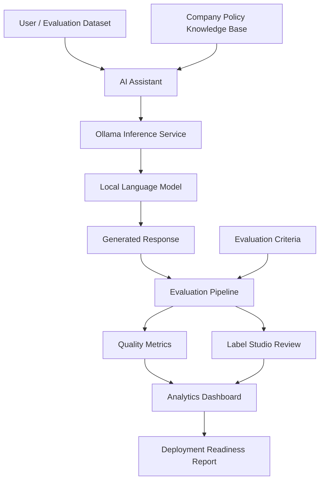

# AI Response Quality Evaluation & Deployment Readiness

### Local LLM Evaluation, Quality Assurance & Deployment Decision Support

An open-source, local-first system for evaluating AI-generated responses, identifying quality risks, comparing language models, and supporting evidence-based deployment decisions.

The platform combines a working LLM-powered knowledge assistant with structured evaluation workflows, automated reporting, interactive dashboards, and human-review integration.

Built using **Python, Ollama, Qwen, and Label Studio**, the system enables reproducible AI quality assessments without requiring commercial LLM APIs.

---

## Overview

Deploying an AI assistant requires more than verifying that it can generate responses.

Organizations need to understand whether an AI system:

- Provides factually correct information.
- Follows its knowledge base and instructions.
- Avoids unsupported claims.
- Handles ambiguous or unanswerable questions appropriately.
- Meets predefined quality and performance requirements.
- Can be considered for deployment based on documented evidence.

**AI Response Quality Evaluation & Deployment Readiness** provides tools for investigating these questions through structured testing, model comparisons, and quality reporting.

The included application focuses on a company-policy knowledge assistant, but the evaluation methodology can be adapted to other question-answering systems.

## Key Features

### Local AI Knowledge Assistant

A functioning AI assistant powered by locally hosted language models.

- Processes natural-language questions.
- Uses a company-policy knowledge base as context.
- Generates responses through Ollama.
- Supports evaluation of factual grounding and unsupported claims.
- Records inference performance.
- Provides a browser-based interface for interacting with the model.

### Structured AI Response Evaluation

Evaluate model-generated responses against predefined quality criteria.

The evaluation framework supports:

- Response correctness assessment.
- Identification of unsupported statements.
- Critical failure classification.
- Test coverage tracking.
- Category-level performance analysis.
- Quality acceptance thresholds.

Evaluation judgments are distinguished from independently human-verified annotations.

### Model Comparison

Compare candidate language models using documented evaluation procedures.

Models tested include:

| Model | Evaluation role |
|---|---|
| Qwen2.5 3B | Selected local baseline |
| Qwen3 4B Instruct | Alternative candidate |
| Llama 3.2 3B | Alternative candidate |

Model comparisons consider response quality, unsupported claims, critical failures, and inference latency.

Matched-question comparisons are used to distinguish genuine performance differences from differences caused by test-set composition.

### Human Evaluation with Label Studio

Integration with Label Studio supports structured review of generated responses.

The evaluation workflow includes:

- Preparing annotation tasks.
- Importing model-generated responses.
- Reviewing response classifications.
- Recording human judgments.
- Keeping synthetic and real-model evaluations separate.

Human annotation remains necessary before treating automated or provisional judgments as independently validated.

### Quality Analytics Dashboard

An interactive reporting interface provides visibility into:

- Evaluation coverage.
- Correctness rates.
- Unsupported-response rates.
- Critical failures.
- Model performance.
- Response latency.
- Deployment acceptance criteria.

Reports support technical investigation and deployment decision-making.

### Deployment Readiness Assessment

The system evaluates results against predefined quality requirements.

Example acceptance criteria:

| Metric | Acceptance threshold |
|---|---|
| Correct responses | ≥ 90% |
| Unsupported responses | ≤ 5% |
| Critical failures | 0 |
| Evaluation coverage | 100% |

These thresholds are configurable project acceptance criteria, not universal standards for AI deployment.

An evaluation report documents whether the tested configuration meets the required thresholds.

---

## System Architecture



### Processing Workflow

1. A user submits a question or starts an evaluation run.
2. The assistant supplies relevant company-policy context.
3. A locally hosted language model generates a response.
4. The response and available inference metadata are recorded.
5. The evaluation pipeline assesses response quality using the configured methodology.
6. Results are aggregated into reports and dashboards.
7. A deployment recommendation is produced based on the acceptance criteria and identified risks.

---

## Technology Stack

| Technology | Purpose |
|---|---|
| Python | Application and evaluation framework |
| Ollama | Local language model inference |
| Qwen2.5 | Primary language model |
| Label Studio | Human annotation and response review |
| HTML / JavaScript | Browser interface and reporting |
| Python unittest | Automated verification |
| Git | Version control |

The core application is designed to operate locally without paid LLM API services.

---

## Getting Started

### Requirements

- Python 3
- Ollama
- Qwen2.5 3B
- Project Python dependencies
- A modern web browser

Local inference performance depends on the available hardware.

### 1. Clone the Repository

```bash
git clone https://github.com/dmitriipetrushin/AI-Response-Quality-Evaluation-Deployment-Readiness.git

cd AI-Response-Quality-Evaluation-Deployment-Readiness
```

### 2. Prepare the Language Model

Install Ollama if it is not already installed.

Official installation instructions:

https://ollama.com

Download the model:

```bash
ollama pull qwen2.5:3b
```

Ensure that the Ollama service is running.

### 3. Start the Application

After installing the project's Python dependencies, run:

```bash
python3 scripts/start_assistant.py --open
```

The startup script launches the local assistant interface.

Open the local URL displayed by the application if the browser does not open automatically.

### 4. Explore the System

Use the assistant interface to submit questions about the included company-policy knowledge base.

For evaluation results, open the reporting dashboard:

`reports/dashboard.html`

Additional evaluation procedures and experiment details are documented in:

`docs/phase-3-experiments.md`

---

## Evaluation Methodology

The system uses structured test cases to assess how reliably language models answer questions using a supplied knowledge base.

Evaluation scenarios include:

- Straightforward questions.
- Questions requiring multiple pieces of information.
- Ambiguous requests.
- Questions that cannot be answered from the knowledge base.
- Sensitive or high-risk scenarios.

Responses are classified into:

**Correct:** The response accurately addresses the question.

**Partially Correct:** The response contains useful information but has significant omissions or inaccuracies.

**Incorrect:** The response fails to provide the expected answer.

**Unsupported:** The response contains claims not adequately supported by the knowledge base.

Critical failures are tracked separately.

### Evaluation Integrity

The system maintains a distinction between:

- Synthetic response fixtures.
- Actual language model outputs.
- Provisional automated or assisted evaluation.
- Independently validated human annotations.

Synthetic results are not presented as measurements of actual model performance.

Comparisons between models should use matched evaluation questions wherever possible.

---

## Experimental Results

The system has been tested using real inference from locally hosted language models.

### Selected Configuration

**Model:** Qwen2.5 3B  
**Inference:** Ollama  
**Hardware:** Intel Core i5-13420H, CPU-only  
**System memory:** Approximately 15 GB

### Expanded Evaluation

| Metric | Observed result |
|---|---:|
| Evaluation cases | 100 |
| Correct responses | 48.0% |
| Unsupported responses | 3.0% |
| Provisional critical failures | 3 |
| Mean response latency | 5.40 seconds |

These results represent a specific experimental configuration and provisional quality assessment.

The tested system did not meet its predefined deployment-quality targets.

### Model Selection

Alternative models were evaluated to determine whether replacement would improve quality.

Qwen3 demonstrated improvements on some validation measures but also introduced unsupported claims and substantially higher latency.

No alternative satisfied the predefined replacement requirements.

**Qwen2.5 3B was retained as the baseline configuration.**

The resulting deployment recommendation was **NO-GO**.

This decision reflects the evaluated response quality and unresolved risks, not a failure of the application to execute inference.

For detailed experimental results, see:

`reports/phase-3-completion-report.md`

---

## Testing & Verification

The implementation includes automated tests covering the application, evaluation pipeline, data handling, and reporting.

The reported verification includes:

- 88 passing unit tests.
- Two successful live integration tests.
- Browser-based application verification.
- Real inference requests.
- Label Studio task import verification.

The evaluation and reporting components distinguish actual model execution from simulated or mocked test responses.

---

## Current Limitations

The system is intended for local experimentation, AI quality analysis, and controlled evaluation.

Known limitations include:

- Response correctness remains below the configured acceptance threshold.
- Quality classifications require independent human validation.
- The included company-policy knowledge base is fictional.
- Evaluation datasets do not establish performance across unrelated business domains.
- Local model performance depends on hardware resources.
- The system has not been approved for production deployment.
- Enterprise authentication, operational monitoring, and production security controls require additional implementation.

**Deployment status: NOT APPROVED FOR PRODUCTION USE.**

---

## Roadmap

Potential future improvements include:

- Additional model and provider integrations.
- Expanded evaluation datasets.
- Independent human annotation and reviewer agreement analysis.
- Improved knowledge retrieval and citation verification.
- Automated regression testing across model versions.
- Additional performance and resource monitoring.
- Configurable evaluation policies.
- Continuous quality monitoring.
- CI/CD integration for deployment quality gates.

---

## Documentation

The repository includes technical documentation, evaluation reports, experiment records, and implementation materials.

Key documents:

- `reports/dashboard.html` — Quality analytics dashboard.
- `reports/phase-3-completion-report.md` — Experimental results and completion report.
- `docs/phase-3-experiments.md` — Experiment configuration and reproduction information.

---

## Intended Applications

The system can be used as a foundation for:

- Local LLM experimentation.
- AI response quality assurance.
- Knowledge-assistant testing.
- Model comparison research.
- Human evaluation workflows.
- Deployment-readiness assessments.
- Investigation of unsupported AI-generated claims.

The platform is an evaluation tool, not a guarantee of model correctness or deployment safety.

---

## Development Status

**Current stage:** Functional local application with experimental evaluation capabilities.

**Deployment status:** Research and testing only.

The system supports real local model inference and reproducible evaluation experiments. Further validation and operational safeguards are required before considering production use.
