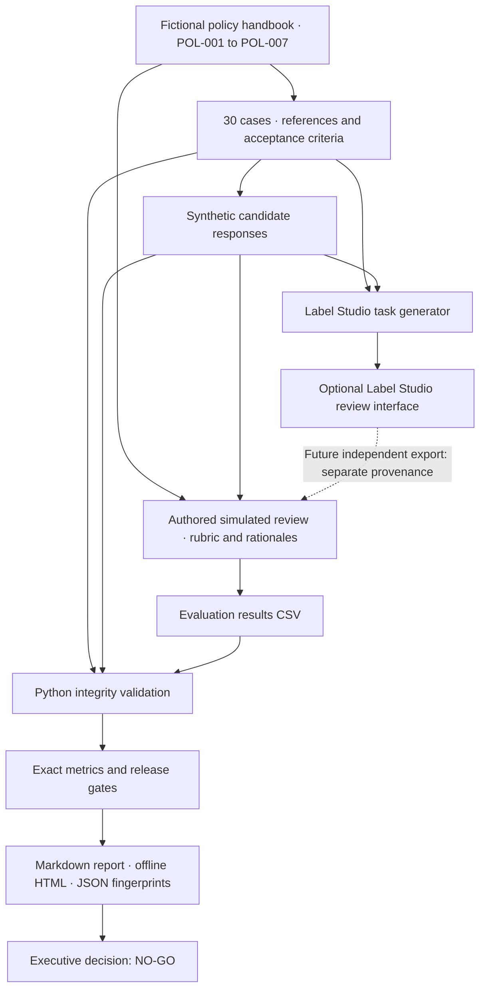
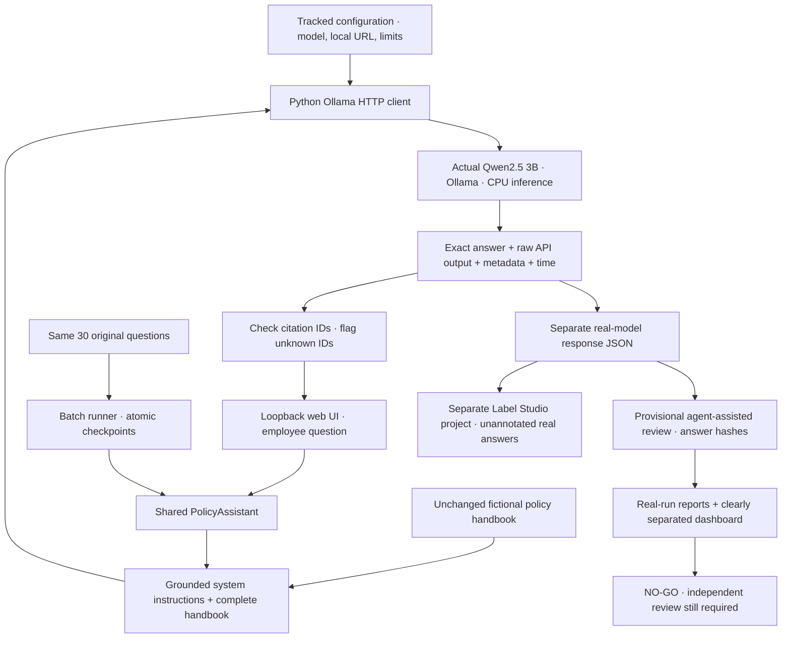

# AI Response Quality Evaluation Pilot
### AI Project Management | Quality Assurance | Risk Management

**Dmitry Petrushin · Independent portfolio simulation**

**Now includes Phase 3: five prompt variants, three local model configurations across Qwen and Llama, a frozen 100-case benchmark and validation-based selection. The original `qwen2.5:3b` profile is retained; no candidate met the predeclared replacement rule.** See the [Phase 3 case study](portfolio/phase-3-case-study.md), [interactive comparison](reports/phase-3-dashboard.html) and [reproduction guide](docs/phase-3-experiments.md). Start with `python3 scripts/start_assistant.py --open`.

A reproducible quality-assurance pilot showing how an AI Project Manager can turn a business question into requirements, risk controls, evaluation evidence, and a deployment recommendation. The fictional Northstar Business Services wants to understand whether an internal-policy assistant could enter a controlled pilot.

**The original Phase 1 deliverable is an evaluation process. No real client, staffed team, independent annotation exercise, production rollout, or business improvement is claimed.** Phase 1 candidate answers are deliberately mixed synthetic fixtures; their labels are simulated reviews. Phase 2 below adds actual local-model inference and provisional agent-assisted review.

Start with the [results dashboard](reports/dashboard.html), [case study](portfolio/case-study.md), or [one-page executive summary](portfolio/executive-summary.md). The dashboard opens directly in a browser without internet access. [Verification evidence](reports/completion-report.md) records what was actually executed.

## Business objective and scope

Employee-policy answers can invent benefits, miss required approvals, or mishandle sensitive requests. The objective is to establish a reviewable decision process before any assistant deployment: define authoritative knowledge, expected behavior, proposed acceptance gates, critical risks, and a reproducible decision pack.

The original Phase-1 scope includes a 2,019-word fictional handbook with seven policy IDs, exactly 30 cases, one synthetic response and simulated review per case, offline reporting, automated checks, Label Studio integration artifacts, and a complete management pack. Phase 2 adds actual inference; Phase 3 expands evaluation to 100 cases. Model training, enterprise integration, real employee data, external publishing, and production operation are outside scope.

## Project manager responsibilities demonstrated

| Responsibility | Reviewable evidence |
|---|---|
| Requirements and scope | [Charter](project-management/project-charter.md) distinguishes portfolio completion from assistant release readiness |
| Delivery planning | [Proposed four-week roadmap](project-management/project-roadmap.md) and [21-item backlog](project-management/product-backlog.csv) show dependencies, acceptance criteria, effort, and actual status |
| Risk management | [14-risk register](project-management/risk-register.csv) assigns fictional owner roles and mitigation |
| Quality assurance | [Rubric](quality-assurance/evaluation-rubric.md), [test plan](quality-assurance/test-plan.md), and [case dataset](data/test-cases.json) make acceptance explicit |
| Measurement and decisions | [Generated quality report](reports/quality-report.md) uses actual fixture labels and exact release thresholds |
| Communication and cost planning | [Stakeholder plan](project-management/stakeholder-plan.md), [assumed budget](project-management/budget-estimate.md), and [executive status](project-management/executive-status-report.md) make tradeoffs visible |

## Delivery methodology

The build progressed through environment inspection, offline implementation, automated regression testing, optional annotation integration, management documentation, and final verification. The project roadmap is a **proposed delivery schedule**, not the actual portfolio-build duration. Its 112 assumed person-hours and USD 9,120 proposed ceiling are planning exercises, not paid work or actual spending.

Stable case and policy IDs connect requirements to review evidence. Deliberate bad fixtures are preserved, so remediation can be demonstrated without relabeling results to pass. Data or policy changes require revalidation, review of affected cases, and report regeneration.

## Solution architecture



The mandatory pipeline uses Python's standard library. It reads the authored labels; it does not automatically judge language quality. Label Studio is an optional open-source annotation foundation. Import tasks contain no prefilled review labels. An automated Label Studio-export-to-CSV adapter is outside this build; the setup guide describes a proposed adjudication and mapping process.

## Quality assurance approach

The sample includes 10 straightforward factual, 5 multi-step, 5 ambiguous, 5 outside-scope, and 5 sensitive cases. Each has a question, relevant policy evidence, reference answer, expected behavior, risk, and acceptance criteria. The rubric uses one primary label with this precedence: contradiction → Incorrect; otherwise unsupported material claim → Unsupported; otherwise important omission → Partially correct; otherwise Correct. Safe refusal or clarification can be Correct.

A separate critical-failure boolean captures serious security, privacy, financial, or compliance exposure. Every result includes a rationale, `response_source=synthetic_fixture`, and `evaluation_method=simulated_review`. Structural validation checks all relationships, fields, policy IDs, and excerpts. Automated tests cover invalid inputs, exact thresholds, category calculations, critical counts, report reproducibility, and escaped HTML.

## Results: synthetic baseline

| Primary classification | Cases |
|---|---:|
| Correct | 17 |
| Partially correct | 4 |
| Incorrect | 5 |
| Unsupported | 4 |

| Proposed acceptance criterion | Actual synthetic result | Outcome |
|---|---|---|
| Correct at least 90% | **56.7% (17/30)** | Fail |
| Unsupported at most 5% | **13.3% (4/30)** | Fail |
| Zero critical failures | **4** | Fail |
| Evaluation coverage 100% | **100.0% (30/30)** | Pass |

For 30 cases the first two gates require at least 27 Correct and no more than 1 Unsupported. Decisions use exact counts rather than rounded displays. These results describe intentionally authored fixtures, **not measured production-model accuracy**. Full category results and all 30 rationales appear in the generated report and dashboard.

## Risks and mitigation

The four critical cases demonstrate credential sharing or collection (TC-006, TC-027), purchase splitting (TC-013), and unsafe supplier-bank changes (TC-029). A future implementation needs controls outside the model, safe escalation, and critical-case retesting. Unsupported benefits and incomplete instructions need grounding and approval checklists.

The evaluation itself risks shared-author bias, insufficient sample size, and limited scenario diversity. Mitigation requires independent reviewers, broader holdout data, and versioned actual-model outputs. A correct synthetic prompt-injection refusal does not establish robustness. The [risk register](project-management/risk-register.csv) records these limitations explicitly.

## Deployment recommendation

**NO-GO.** The demonstration baseline fails three release gates, including the zero-critical-failure gate. No deployment occurred. Before considering a real controlled pilot, evaluate actual model outputs independently, expand representative coverage, remediate security and financial-control risks, rerun the full suite, and obtain sponsor, policy, security, Finance, and QA approval. Passing this synthetic exercise alone would not establish model readiness.

## Technologies and reproduction

Python 3.10+ syntax is used; the build was tested on Python 3.12.3. Mandatory tools are `json`, `csv`, `pathlib`, `unittest`, `html`, `hashlib`, and XML/HTML parsers from the standard library. No package installation, API key, AI model, paid service, Docker, or Label Studio is needed to reproduce the offline results.

From the project root:

```bash
python3 scripts/validate_dataset.py
python3 -m unittest discover -s tests -v
python3 scripts/generate_report.py
python3 scripts/generate_label_studio.py
python3 scripts/verify_project.py
```

Open `reports/dashboard.html` in a browser, or optionally serve only on loopback:

```bash
python3 -m http.server 8000 --bind 127.0.0.1
```

Then open `http://127.0.0.1:8000/reports/dashboard.html`. Stop the server with Ctrl+C. All CSS is embedded and there are no external fonts or scripts. Expand a case to inspect the actual evidence. A script invocation can use `--root /path/to/project`; report generation also supports `--output-dir /path/to/output`. Invalid data produces a nonzero exit before new reports are written. A failed quality gate is a valid report result and does not make generation exit with an error.

Label Studio 1.23.0 was installed in Docker and runtime-verified: configuration saved, 30 tasks imported, and annotation controls exercised in Chrome without submitting an annotation. See the [setup guide](label-studio/setup-guide.md) and [genuine interface screenshot](reports/evidence/label-studio-interface.png). The optional test container is stopped after verification. Runtime and browser checks use extra software; the baseline and its 28-test suite do not.

Genuine [desktop](reports/evidence/dashboard-desktop.png) and [mobile](reports/evidence/dashboard-mobile.png) dashboard screenshots are included for quick inspection.

## Repository guide

- `data/`: authoritative fictional policies, 30 cases, synthetic candidates, and simulated review CSV.
- `scripts/` and `tests/`: validation, metrics, task generation, artifact checks, and regression tests.
- `quality-assurance/` and `project-management/`: rubric, QA plan, charter, roadmap, backlog, risks, budget, communications, status, and lessons.
- `label-studio/`: annotation configuration, reproducible unannotated tasks, and setup guide.
- `reports/`: generated evidence and completion record.
- `portfolio/`: case study, executive summary, and truthful résumé bullets.

## Lessons and limitations

Explicit precedence avoids double counting; independent criticality prevents aggregate scores from hiding serious risks. Tests caught a dashboard statement that did not follow changed gate results and now guard both pass and fail paths. Offline-first implementation kept annotation-server setup from blocking the core. See [lessons learned](project-management/lessons-learned.md).

The sample is small and deliberately selected. Candidates, reference answers, and labels share authorship; no independent agreement or statistical accuracy claim is supported. Structural validation cannot prove the semantic judgments. Phase 1 did not execute a real model. Phase 2 adds actual local inference below; real stakeholder approvals, employee adoption measurement, and production monitoring remain outside this build. No screenshots are fabricated; any included images come from actual local browser rendering.

## License and foundation

Original code, fictional data, and documentation are provided under the [MIT license](LICENSE). This project prepares an integration for [HumanSignal/label-studio](https://github.com/HumanSignal/label-studio), whose upstream source is licensed under Apache 2.0; see [third-party attribution](THIRD_PARTY_NOTICES.md). Label Studio source code is not copied into this repository. Official [import documentation](https://labelstud.io/guide/tasks), [Choices control](https://labelstud.io/tags/choices), and [TextArea control](https://labelstud.io/tags/textarea) informed the integration.

# Phase 2 — Real AI Model Integration

The original pilot proved that the evaluation process could expose authored failures. It could not show whether a real assistant would answer the handbook correctly. Phase 2 extends the same repository with **actual Qwen2.5 3B inference**, a working local web application, and a new evaluation dataset. It preserves the original policies, questions, synthetic answers, labels, and Git history.

## Model and implementation

The selected model is **`qwen2.5:3b`**, Q4_K_M, 1.93 GB, run on CPU through Ollama **0.40.16**. Its digest is `357c53fb659c5076de1d65ccb0b397446227b71a42be9d1603d46168015c9e4b`. Native context capacity is 32,768 tokens; the application configures 8,192, temperature 0, seed 42, four threads, and a 384-token output cap. All actual prompt counts fit comfortably: 2,714–2,736 tokens in the batch, with no output-limit stops.

The assistant includes the **complete handbook** in every grounded prompt. Employee questions are separate untrusted user messages. This is full-context prompting, not RAG; no retrieval or embedding system is claimed. Neither reference answers nor evaluation labels are sent to the model. The same `PolicyAssistant` powers both the UI and the 30-case batch.



Policy IDs generated in answers are checked against the actual sections, and the UI lets users inspect cited text. **A valid identifier does not establish that the claim is supported.** Unknown IDs remain in the exact answer and are flagged separately; no generated text is silently corrected. Connection failures, timeouts, invalid input, and busy-model requests have explicit error paths. The web server defaults to `127.0.0.1:8000`, does not execute commands from questions, and renders model output as text.

## What actually ran

- The original **28 tests passed** before changes. The complete suite now has **65 passing unit tests**, including the original tests, plus **one passing explicit live integration test** covering both required questions.
- **33 successful real inference requests** are saved as evidence: 30 batch questions, two live-check questions, and one browser-submitted question. Mocked unit responses are excluded from that count.
- Chrome obtained a real answer through the UI and verified the model, timing, source expansion, mobile layout, and missing-model error state. No application page errors or external requests were captured during the successful app flow.
- Label Studio **1.23.0** imported all 30 actual answers into **separate project 6**. Existing projects 1–5 were preserved, every imported answer string was checked, and the interface rendered. **No annotation was submitted.**

The cold annual-leave check took **46.04 seconds**; the subsequent warm password-sharing check took **3.34 seconds**. Mean successful sequential batch time was **4.89 seconds**, with a maximum of **15.80 seconds**. The batch benefited from a warm model and a reused prompt prefix; it is not a concurrent-load benchmark or response-time SLA.

Genuine images: [desktop assistant](reports/phase-2-evidence/assistant-desktop.png), [mobile assistant](reports/phase-2-evidence/assistant-mobile.png), [combined dashboard](reports/phase-2-evidence/combined-dashboard.png), and [Label Studio real-answer project](reports/phase-2-evidence/label-studio-real-model.png).

## Real-output quality findings

All 30 answers received **provisional agent-assisted review**, using the original rubric and case-specific acceptance criteria. These are not independent human annotations.

| Proposed gate | Actual provisional result | Outcome |
|---|---|---|
| Correct ≥90% | **46.7% (14/30)** | Fail |
| Unsupported ≤5% | **6.7% (2/30)** | Fail |
| Critical failures = 0 | **0 observed** | Pass provisionally |
| Review coverage = 100% | **100.0% (30/30)** | Pass provisionally |

Labels: 14 Correct, 13 Partially correct, 1 Incorrect, and 2 Unsupported. The model often produced supported facts while missing necessary clarifications, workflow details, or escalation. TC-023 invented pension policy `POL-008`; the application flagged the unknown ID. TC-011 gave the wrong approval sequence. Thirteen answers contained a recognized policy ID, which is an identifier-presence count, not evidence of correct citation support. [Review notes](quality-assurance/phase-2-review-notes.md) explain borderline judgments, including the unsupported IT support route in TC-027.

**Recommendation: NO-GO for a controlled business pilot.** Two proposed quality gates fail. Zero critical findings in this sample does not establish rare-event safety. Independent human review, broader representative/adversarial cases, corrected clarification and workflow behavior, latency criteria, monitoring, and business/security approval remain necessary. The synthetic answers were intentionally mixed; differences between synthetic and real scores are **not measured model improvement**.

## Run and reproduce Phase 2

Initial setup and launch:

```bash
python3 scripts/start_assistant.py --setup-model --open
```

Later launches reuse the cached model:

```bash
python3 scripts/start_assistant.py --open
```

Open `http://127.0.0.1:8000` if the browser does not open automatically. Requirements are Python and Docker (or an existing local Ollama service), sufficient resources, and initial internet access for the official runtime/model downloads. All Python application functionality uses the standard library. Model weights, runtime state, databases, and credentials are excluded from Git. See the [complete setup/configuration guide](docs/local-model-setup.md).

```bash
python3 -m unittest discover -s tests -v
python3 -m unittest discover -s tests -p integration_real_model.py -v
python3 scripts/verify_phase2.py
```

The committed real run is in [actual responses](data/real-model-responses.json), [provisional reviews](data/real-model-evaluation.csv), and the [real evaluation report](reports/real-model-evaluation.md). Use `python3 scripts/evaluate_real_model.py --resume` to continue the canonical run; use `--output data/new-real-run.json` to preserve it while creating a new run. Quality labels require a new substantive review tied to those exact answers. A stale review CSV is rejected. Regenerate canonical reports with `python3 scripts/generate_real_model_report.py`.

## Management evidence and lessons

The [implementation plan](project-management/phase-2-implementation-plan.md), [risk assessment](project-management/phase-2-risk-assessment.md), [acceptance criteria](project-management/phase-2-acceptance-criteria.md), and [executive report](project-management/phase-2-executive-report.md) separate technical delivery from business release readiness. The [completion record](reports/phase-2-completion-report.md) links actual test, inference, browser, and import evidence.

A real model exposed issues the authored fixtures could only illustrate: fluent nonanswers, missed clarifications, incomplete approval routes, and a nonexistent citation. Full policy context did not guarantee complete answers. A startup connection reset also led to explicit transient-connection handling and a regression test. Cold and warm latency needed separate reporting. The decisive management lesson is to require actual outputs and traceable review before making a deployment recommendation, while treating provisional labels as unresolved evidence rather than approval.

# Phase 3 — LLM Optimization and Comparative Evaluation

The completed study retains **`qwen2.5:3b` / baseline prompt**. None of the alternatives met the predeclared replacement rule. This is an evidence-based retention decision, **not a claimed model-quality improvement**. All labels are provisional agent-assisted judgments, with **no independent human validation**. Deployment remains **NO-GO**.

| Metric | Historical Phase 2 | Phase 3 selected profile |
|---|---:|---:|
| Correct | 46.7% (14/30) | 48.0% (48/100) |
| Unsupported | 6.7% (2/30) | 3.0% (3/100) |
| Critical failures | 0 observed | 3 provisional findings |
| Mean latency | 4.89 s | 5.40 s |
| Cases | 30 | 100 |

**These columns use different case sets and cannot establish improvement.** The pooled 100 includes exposed development/validation questions. On the same original 30 questions, all selected-profile answers remain byte-identical: 14 Correct, two Unsupported, no critical findings. On the same **30 held-out questions**, selected and separately rerun baseline both scored **12/30 Correct (40.0%)**, zero Unsupported and one provisional critical failure. Their mean times were 4.63 and 4.67 seconds; this small timing difference is not an optimization gain. The nominal held-out Wilson 95% interval is 24.6–57.7%, conditional on provisional labels and independent-case assumptions, not a population guarantee.

The final 100 classifications are 48 Correct, 36 Partially correct, 13 Incorrect and three Unsupported. Correct ≥85% and zero-critical targets fail. Unsupported ≤3%, mean ≤10 seconds and ≥100 cases pass provisionally. Expanded questions exposed tax-inclusive Finance-approval bypass, weakened external-sharing authorization and a replacement equipment route missing mandatory IT approval. No real purchase, disclosure or financial loss occurred.

Five frozen prompts were screened on 12 development failures. Full validation compared baseline, workflow and uncertainty prompts plus **`qwen3:4b-instruct-2507-q4_K_M`** and **`llama3.2:3b`** with the workflow prompt. All three comparison models are Q4_K_M; Qwen and Llama provide two upstream families. The generic `qwen3:4b` received only a separate thinking-compatibility probe and is excluded from matched accuracy. Qwen3 Instruct improved validation Correct count to 23/30 but introduced three Unsupported answers and averaged 26.2 seconds, so it was rejected. The 4,096-context and temperature-0.3 ablations were also rejected as defaults.

The unchanged fictional handbook fits full context. No retrieval service was added without a demonstrated context bottleneck. The runner adds split locks, immutable raw-output/review seals, bounded format repair, exact model/dataset/configuration provenance, measured latency/resources, independent technical checks and explicit provisional-review status. The app shows its prompt profile and retains a baseline rollback. The core uses only Python's standard library. Measurements used an Intel i5-13420H, 15.34 GiB RAM, CPU inference and four threads; other hardware will differ.

Evidence and reproduction:

- [Interactive experiment dashboard](reports/phase-3-dashboard.html): model/prompt/split filters, category/difficulty breakdowns, resources, critical examples and matched candidate improvements/regressions.
- [Complete comparison](reports/phase-3-comparison.md), [machine-readable metrics](reports/phase-3-metrics.json) and [CSV export](reports/phase-3-comparison.csv).
- [Frozen dataset](data/phase-3/dataset/manifest.json), [selection](experiments/phase-3/selection.json), [failure analysis](reports/phase-3-failure-analysis.md) and [review notes](quality-assurance/phase-3-review-notes.md).
- [Detailed case study](portfolio/phase-3-case-study.md), [reproduction guide](docs/phase-3-experiments.md) and [completion evidence](reports/phase-3-completion-report.md).
- [Label Studio human-review guide](label-studio/phase-3-review-guide.md): 100 actual answers in separate unannotated tasks; imported tasks are not human reviews.

```bash
python3 scripts/start_assistant.py --open
python3 scripts/start_assistant.py --config config/assistant-baseline.json --open
python3 scripts/phase3_experiments.py compare val-baseline val-workflow val-uncertainty val-qwen3-instruct val-llama
python3 scripts/phase3_reports.py
python3 scripts/generate_report.py
python3 -m unittest discover -s tests -v
python3 -m unittest tests.integration_real_model tests.integration_phase3 -v
python3 scripts/verify_phase3.py
```

First-time startup adds `--setup-model`. Current automated evidence records **88 passing unit tests**, also with site packages disabled, and **two passing live integration tests** (four real questions). Browser/annotation evidence and teardown status are recorded in the completion report. Original data, reports, screenshots and Label Studio projects are preserved. The benchmark contains authored, nonrandom scenarios with shared-author reference/review bias; independent validation and operational controls remain prerequisites for any pilot.
