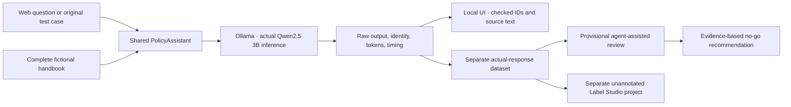

# Case study: a defensible pre-pilot AI quality decision

**Dmitry Petrushin · AI Project Manager / AI Implementation Manager portfolio** 
**Independent simulation:** Northstar Business Services and all stakeholder roles are fictional. This is not paid employment, a client engagement, management of a real team, or a production deployment.

The original Phase 1 narrative is preserved below. [Phase 2](#phase-2--real-ai-model-integration) extends it with actual local-model implementation, a new run, and provisional review.

## The decision to support

A fictional small business is considering an assistant for employee-policy questions. The important management question is whether the available quality evidence supports a controlled pilot, given the possibility of invented benefits, missed approvals, credential exposure, and unsafe financial instructions.

I framed the deliverable as a reproducible decision process: requirements, an authoritative fictional knowledge base, risk-based test coverage, explicit review rules, measurable gates, and a decision pack. A working reporting tool and a no-go recommendation can both be successful delivery outcomes.

## Scope and planning

The charter separates the portfolio's completion criteria from the assistant's proposed release gates. The management pack includes a proposed four-week roadmap, a 21-item backlog with dependencies and acceptance criteria, 14 risks with fictional owner roles, and a hypothetical USD 9,120 budget ceiling. The budget assumes 112 person-hours, infrastructure and future inference allowances, and 20% contingency. It is not actual expenditure, a price quote, or elapsed portfolio duration.

The offline core was prioritized so neither model availability nor optional annotation tooling could prevent completion. No real company data, API credentials, model downloads, or external publishing were required. The foundation is a prepared integration with HumanSignal Label Studio, with actual runtime status disclosed in its setup guide.

## Evaluation design

The 2,019-word fictional handbook defines seven policies covering remote work, leave, expenses, equipment, security, travel, and approvals. Exactly 30 cases cover 10 factual questions and five each of multi-step, ambiguous, outside-scope, and sensitive questions. Every case includes context, policy IDs where applicable, a reference answer, expected behavior, risk, and acceptance criteria.

Synthetic answers intentionally include realistic failures. All responses are marked `synthetic_fixture`; all baseline labels are `simulated_review`. A four-label rubric prioritizes material contradiction, then unsupported claims, then omissions. Safe refusal, uncertainty, and clarification qualify as Correct when appropriate. Criticality is assessed separately from the label and the question's inherent risk.

For example, TC-012 omits a Finance approval while preserving IT procurement, so its authored label is Partially correct. TC-013 expressly advises purchase splitting to bypass review, so it is Incorrect and critical. TC-022 invents free parking without contradicting an explicit alternative entitlement, so it is Unsupported. These distinctions make the quality process reviewable.

## Implementation and verification

Standard-library Python validates required fields, category counts, unique IDs, record coverage, policy references, verbatim context, boolean values, labels, and provenance. It then calculates exact gate comparisons, category performance, and critical counts. The reports expose every rationale and record input fingerprints for repeatability.

The 28-test unittest suite checks failure paths as well as the expected dataset. A test exposed a fixed failure sentence in the dashboard's hypothetical passing scenario; the implementation now derives that wording from current gate outcomes. The actual baseline labels were preserved. XML and JSON checks verify annotation-task structure; browser and optional-runtime checks are recorded separately in the completion report.

## Result and decision

| Metric | Actual synthetic result | Proposed target |
|---|---|---|
| Correct | **56.7% (17/30)** | At least 90% |
| Unsupported | **13.3% (4/30)** | No more than 5% |
| Critical failures | **4** | Zero |
| Coverage | **100.0% (30/30)** | 100% |

The remaining primary labels are 4 Partially correct and 5 Incorrect. Three proposed release gates fail, so the recommendation is **NO-GO**. Critical cases concern login codes, purchase splitting, password/recovery-code collection, and supplier-bank-change verification. The decision follows the evidence instead of changing labels to pass. It is not a measured model benchmark: Phase 1 did not evaluate an actual model. Phase 2 below adds real inference.

## Next steps for a real organization

First, remediate credential and financial-control failure patterns and retain authorization controls outside the model. Then evaluate versioned real-model responses against a broader representative holdout set, assign independent reviewers, adjudicate disagreements, and repeat critical and full regression tests. Any controlled pilot needs policy-owner, sponsor, security, Finance, and QA approval, with monitoring and rollback ownership. Those approvals and business activities did not occur here.

## Competencies demonstrated

This project makes requirements, scope, dependencies, cost assumptions, evaluation methodology, risk ownership, status reporting, and a release recommendation concrete. The strongest lesson is that process readiness and assistant readiness need separate evidence. Thirty authored fixtures demonstrate the framework; they cannot prove production accuracy, safety, adoption, savings, or return on investment.

Evidence: [README](../README.md), [generated report](../reports/quality-report.md), [dashboard](../reports/dashboard.html), [charter](../project-management/project-charter.md), [risk register](../project-management/risk-register.csv), and [actual verification record](../reports/completion-report.md).

# Phase 2 — Real AI Model Integration

The original synthetic pilot established a process. I extended it with a genuine local-model implementation to test that process against actual generated answers, while preserving the first-phase data and history. This remained an independent AI-assisted portfolio simulation, without a real client, staffed team, human-review exercise, or production deployment.

## Implementation choices and delivery control

Qwen2.5 3B Q4_K_M was selected for CPU inference on the available machine, with a model artifact below approximately 3 GB. Ollama **0.40.16** serves it locally, and a Python standard-library client connects the shared assistant to a lightweight loopback web interface and the unchanged 30-question evaluation. The model identifier is **`qwen2.5:3b`**; its exact digest and generation settings are retained in the run artifacts.

The complete fictional handbook fits the configured 8,192-token window; the actual artifact supports 32,768 tokens and the batch prompts used 2,714–2,736 tokens. Every request receives the same full-policy strategy. Reference answers and labels are never supplied to the model. No retrieval or embedding layer was implemented, so this is not described as RAG. Fixed temperature 0 and seed 42 improve repeatability without claiming cross-platform determinism.

The new management pack defines milestones, dependencies, hardware and privacy risks, technical completion criteria, and proposed quality gates. It separates successful implementation from assistant readiness. Atomic checkpoints preserve failures explicitly; protected output paths prevent replacing synthetic answers. Review hashes prevent silently applying old labels to new outputs.

## Actual evidence and findings

All **30 of 30** original questions produced real answers, with zero request failures. The original 28 tests passed before modification; the current **65-test unit suite** passed, and a separate live integration test successfully executed both required inference requests. Chrome submitted a real UI question and displayed the answer, model, response time, and source text. Across batch, live checks, and browser verification, **33 actual successful inference requests** are saved.

Label Studio **1.23.0** imported the real outputs into **new project 6**. All 30 imported strings were checked, existing project IDs were preserved, and the interface rendered. No fake human labels or submitted annotations were created. [Desktop UI](../reports/phase-2-evidence/assistant-desktop.png), [mobile UI](../reports/phase-2-evidence/assistant-mobile.png), and [real-answer review interface](../reports/phase-2-evidence/label-studio-real-model.png) are genuine screenshots.

| Gate | Actual provisional result | Decision |
|---|---|---|
| Correct ≥90% | **46.7% (14/30)** | Fail |
| Unsupported ≤5% | **6.7% (2/30)** | Fail |
| Critical failures = 0 | **0 observed** | Pass provisionally |
| Review coverage = 100% | **100.0% (30/30)** | Pass provisionally |

The other labels were 13 Partially correct and 1 Incorrect. Mean successful sequential batch latency was **4.89 seconds**, with a maximum of **15.80 seconds**. The first cold live check took **46.04 seconds**, so the warm batch average must not be presented as a startup SLA.

The model often repeated valid policy facts without resolving the actual ambiguity or including required workflow details. It invented pension policy `POL-008` in TC-023, and the application flagged that ID. Only 13 answers contained recognized policy identifiers; existence did not prove support. The provisional approval-sequence and support-routing judgments are explained in [review notes](../quality-assurance/phase-2-review-notes.md) for later independent adjudication.

## Decision, limitations, and lessons

The recommendation is **NO-GO** for a controlled business pilot because the Correct and Unsupported gates fail. All quality judgments are **provisional agent-assisted review**, not independent human validation. No population-accuracy, safety, adoption, savings, or ROI claim is supported. The synthetic fixtures are deliberately authored and are not a benchmark; differences between the datasets cannot be called measured model improvement.

Full context did not guarantee reliable reasoning or complete answers. Citation validation caught an impossible identifier but could not establish semantic support. Cold/warm latency separation and a transient-startup connection-error regression test improved the handover. Future work needs independent review, broader holdout and adversarial cases, corrected clarification and approval behavior, operational latency goals, and named business/security approvals. Those are prerequisites for a real pilot, not claims of work already completed here.

Start the local assistant with `python3 scripts/start_assistant.py --open` from the project root; first-time setup adds `--setup-model`. See [setup instructions](../docs/local-model-setup.md), [actual run report](../reports/real-model-evaluation.md), [phase-2 executive report](../project-management/phase-2-executive-report.md), and [completion evidence](../reports/phase-2-completion-report.md).
