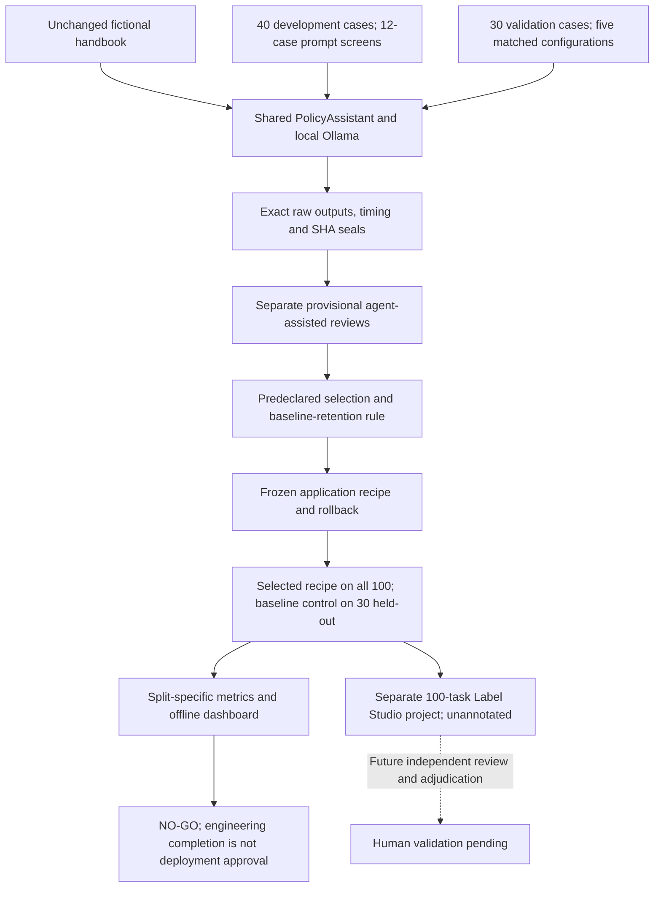

# Phase 3 — Optimizing a local policy assistant through comparative evaluation

**Dmitry Petrushin · Independent AI-assisted portfolio simulation**

The application is a functioning local assistant for a fictional company's internal handbook. This study uses actual model inference, with **provisional agent-assisted reviews**. It does not represent a client engagement, independent human annotation exercise, production deployment or measured business impact. The deployment recommendation is **NO-GO**.

## Problem and evidence

Phase 2 achieved 14 Correct answers out of 30 (46.7%), two Unsupported answers (6.7%), no observed critical failures and a 4.89-second mean on Qwen2.5 3B. A working UI and grounded prompts did not establish reliable policy guidance. The engineering question was whether better instructions, inference settings or a stronger locally runnable model would improve quality within a ten-second mean response-time target on the available CPU.

I first reproduced the original configuration before changing the default application. All 30 generated answers matched historical text exactly. The replay mean was 6.11 seconds and included cold-start work; it is not a fair latency comparison with the historical warm batch. The policy handbook, questions, synthetic results, Phase-2 responses, reviews and reports were fingerprinted and retained. The full verification log and baseline comparison are under `reports/phase-3-evidence/`.

The [failure analysis](../reports/phase-3-failure-analysis.md) examined all 16 original non-Correct outputs. Ten omitted important workflow or safety details; two misinterpreted the question, one confused workflow, one refused unnecessarily, one invented a policy citation and one invented a support route. The semantic labels are provisional. The absence of an invented policy identifier is a deterministic fact; explanations of the model's causes are hypotheses. This distinction prevents a structural test from becoming an unearned accuracy claim.

Examples informed experiments rather than answer templates. Expense guidance often gave the deadline but omitted ExpenseDesk. A credential refusal could be safe yet omit the approved support route. An ambiguous request could trigger an annual-leave answer without asking what the person intended. The proposed remedies were generic completeness, interpretation and uncertainty instructions—not hardcoded responses to benchmark IDs.

## Evaluation design

The benchmark expanded to 100 policy-grounded cases: 40 development, 30 validation and 30 held out. The original 30 are preserved development cases. New cases cover factual boundaries, multi-step approval chains, ambiguous requests, unavailable benefits, conflicting instructions, privacy, security and financial controls. Each case has a stable identifier, expected behavior, reference answer, criteria, category, difficulty, risk severity, scenario group and source context. The new reference answers are explicitly marked for independent human validation.

Dataset and prompt hashes were frozen before experiments. Duplicate normalized questions and cross-split scenario groups are rejected. A held-out execution gate prevents inference on the final questions until validation selection is frozen. Reference answers and labels never enter the model prompt. These controls limit accidental leakage, but cannot establish independent authorship: the same agent authored the new questions/references and reviewed answers. The held-out test therefore measures unseen questions within this authored handbook, not an independently blind external benchmark or a sample of real employee traffic.

Five prompts were frozen: historical baseline, instruction-focused, uncertainty-aware, policy workflow and structured JSON output. A 12-question development screen deliberately emphasized historical failures. Its Correct percentage must not be compared with the complete historical 30-case percentage. The strongest two nonbaseline prompt approaches proceeded to the same full 30-case validation set alongside baseline and the cross-model candidates. Prompts were not rewritten after validation or held-out observations.

Quality follows the existing rubric: contradiction → Incorrect; otherwise material unsupported assertion → Unsupported; otherwise important omission → Partially correct; otherwise Correct. Criticality is a separate judgment about serious weakened privacy, security or financial controls. A safe but incomplete refusal can be Partial without being critical. A complete substantive answer can have a separately recorded formatting/citation weakness. This matters when a repeated checklist contains correct facts but reaches the output limit: the technical failure is still counted and penalized, rather than hidden by its semantic label.

## Hardware and controlled comparisons

The measured computer has an Intel Core i5-13420H, 12 logical CPUs and approximately 15.34 GiB RAM. Inference ran on CPU through Ollama 0.40.16 with four configured threads. No allocated GPU or peak-VRAM measurement is claimed. The three matched model configurations use Q4_K_M weights: Qwen2.5 3B, Qwen3 4B Instruct 2507 and Llama 3.2 3B. Qwen and Llama provide two model families. Each artifact is under 3 GB on disk; exact identifiers and digests are recorded with every real response.

The generic `qwen3:4b` alias exposed thinking-only behavior in the installed runtime. A real compatibility probe took 116.6 seconds cold despite `think:false`; that single output was not treated as benchmark accuracy. The explicit `qwen3:4b-instruct-2507-q4_K_M` candidate provided the intended non-thinking comparison. Checking actual tag capabilities avoided presenting mismatched reasoning modes as a controlled model comparison.

The nominal comparison settings are temperature 0, seed 42, context 8,192 and maximum 384 output tokens. A separate full-prompt warm-up is saved and excluded from case timing. Cases run sequentially through the same `PolicyAssistant` as the UI. The output cap has different word budgets under different tokenizers; that limit is disclosed. Host load and caching can change latency. Early development screens overlapped model downloads; validation and final runs did not. This is a local engineering benchmark, not a tightly controlled performance-laboratory result.

Memory evidence distinguishes Ollama's loaded-model byte count from a separate Docker container-usage snapshot. Neither is labeled as peak RSS or peak VRAM. A 4,096-context ablation reduced loaded-model size by roughly 252 MB, generated the same 12 answers as the workflow screen and did not produce a speed gain. It was rejected as a default change. Temperature 0.3 reduced development correctness relative to deterministic workflow generation and introduced an unsupported answer; it was also rejected.

## Engineering changes and decisions

The new runner records experiment ID, timestamp, Git commit, source hashes, exact model identity, prompt version, dataset fingerprint, generation settings, warm-up, raw responses, stop reasons and latency. It appends one checkpoint per attempted case. Completed response and review files are sealed and cannot be overwritten through the CLI. Resource and warm-up evidence has an additional seal. Interrupted inference can resume only with matching inputs/configuration and inference source; sealed runs remain immutable. A runtime error is retained as an error, never replaced by a mock answer.

Structured generation uses a strict schema with a natural-language `answer`, response type and actual policy identifiers. The client validates types, nonempty/bounded text, allowed response types and duplicate/unknown references. It permits at most one technical format-repair retry and stores both attempts. Plain-text semantic errors do not trigger hidden retries. The development structured profile nevertheless produced mostly terse, incomplete answers and one critical invented approval threshold. A valid JSON schema proved insufficient for semantic quality, so this profile was not adopted for the employee UI.

The full handbook is only 2,019 words and fits comfortably in the measured context. Baseline failures mainly concerned omitted steps, interpretation and instruction following. I did not add a retrieval service: retrieving only one section could omit cross-policy approval constraints, and there was no demonstrated context-capacity bottleneck. This is a documented scope/feasibility decision, not a claim that an untested RAG system would necessarily perform worse.

The application retains loopback binding, bounded requests, understandable transport errors, text rendering and inspectable citations. It now shows the active prompt profile. Unknown policy identifiers and truncated generation remain visible warnings; identifier existence does not prove claim support. The selected recipe is installed in `config/assistant.json`, and `config/assistant-baseline.json` provides an explicit rollback. The legacy evaluator intentionally uses the baseline to keep historical replay meaningful.

## Selection, reporting and human review

The protocol was recorded before validation. Selection prioritizes observed critical failures, request failures, truncated answers, number of violated engineering targets, Correct count, Unsupported count, latency and loaded-model size. Replacing baseline also requires at least two additional Correct validation answers without more critical or Unsupported outcomes. This practical minimum is not a statistical-significance claim. A candidate's better development score alone cannot change the application default.

Qwen3 Instruct illustrates the tradeoff: its validation result was 23/30 Correct (76.7%), zero observed critical failures, three Unsupported answers and a 26.2-second mean. Greater detail improved some approval explanations but also added invented disciplinary consequences, confidentiality agreements and a support route. The frozen minimum-gain rule did not permit adopting that tradeoff. The complete [comparison report](../reports/phase-3-comparison.md) includes all configurations, final selection, held-out measurements, category/difficulty breakdowns and paired improvement/regression examples.

The main dashboard extends the existing synthetic and Phase-2 evidence with a separate Phase-3 view. Filters compare model, prompt and split. Individual examples distinguish exposed original questions from the final question holdout. Mean, median, P95, memory metadata and review coverage accompany quality percentages. Nominal Wilson intervals condition on the provisional labels and independent-case assumptions; shared-policy, nonrandom authored questions do not justify population-accuracy guarantees. The pooled 100-case result includes development and validation examples and is always reported separately from the 30-case held-out comparison.

Label Studio receives the actual final answers in a separate 100-task project. Tasks bind question, experiment, model/digest, prompt, exact response and SHA-256 to relevant policy evidence and authored reference criteria. Imported tasks have no annotations or predictions. Provisional labels stay outside the annotation UI. Reviewers can classify answers, flag criticality, select failure reasons/severity and explain decisions. Historical project exports are compared before and after import. UI exercise does not constitute independent human validation. The [review guide](../label-studio/phase-3-review-guide.md) describes reference validation, calibration and adjudication.

## Practical skills and limits

This work demonstrates local AI integration, evaluation design, reproducible experiments, model/prompt comparison, response-contract validation, regression testing, real browser verification and evidence-based release decisions. It also demonstrates rejecting interventions that fail validation rather than changing reference answers or passing off structural checks as model accuracy.

The remaining limits are substantive: one fictional handbook, a small authored benchmark, shared-author review bias, uncertain borderline labels, no reviewer agreement, no production security assessment, no real employee data, no stakeholder authorization and no measured adoption or business outcome. A zero critical count in any sample does not establish absence of critical risk. Further development needs independent policy-owner/reference validation, independent blinded answer review, representative/adversarial questions and operational safeguards outside the model. Deployment remains NO-GO.

See the [reproduction guide](../docs/phase-3-experiments.md) for startup, rollback, experiment commands, immutable replay rules, test commands and service teardown. The completion report records final executed checks and selected/held-out results.

## Final measured result

The frozen rule retained Qwen2.5 3B with its original prompt. Across 100 actual outputs: **48 Correct, 36 Partially correct, 13 Incorrect, three Unsupported; three provisional critical findings**. Mean/median/P95 latency was **5.40/4.26/12.62 seconds**, with one output-limit stop. Correct ≥85% and zero-critical targets were not met; the full-pool Unsupported ≤3%, latency ≤10-second mean and 100-case coverage targets were met provisionally.

Matched held-out selected/control results were both **12/30 Correct (40.0%)**, zero Unsupported and one critical finding, with byte-identical outputs. Mean times were 4.63/4.67 seconds. The nominal Wilson interval is 24.6–57.7%; it conditions on the unvalidated labels and does not establish population accuracy. All original 30 outputs also matched historical text exactly, so no improvement is claimed. The 48% pooled score and historical 46.7% use different case sets.

The expanded benchmark identified critical advice in P3-D-004 (ignoring tax and waiving Finance approval), P3-V-018 (People Operations OR owner instead of owner AND InfoSec for external sharing) and P3-T-010 (replacing mandatory IT equipment approval with a different route). These are potential exposure in generated advice, not actual transactions or disclosure. The broader benchmark reveals weaknesses in the retained model; the optimization did not cause a new production incident.

The delivered outcome is a functioning assistant plus a more auditable evaluation system and an unsuccessful optimization result, honestly reported. It supports continued evaluation and remediation, **not deployment**. The completion record links actual unit, live-inference, browser, annotation-preservation and service-teardown checks.
